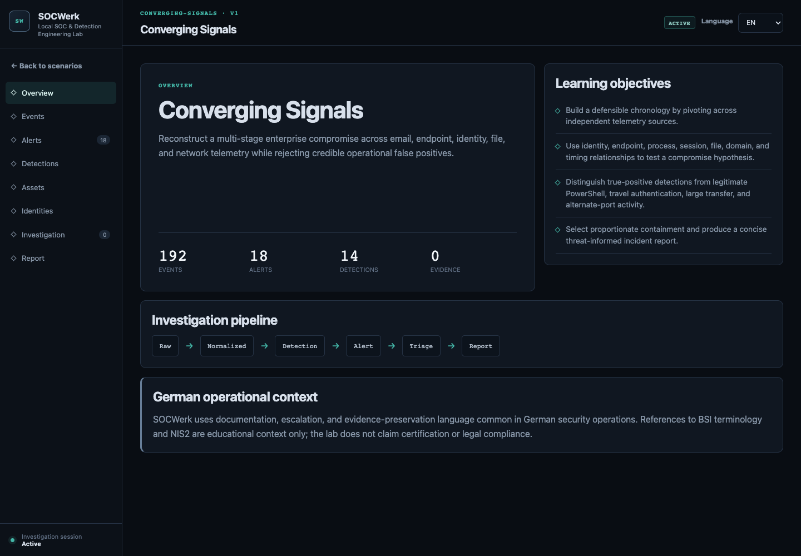
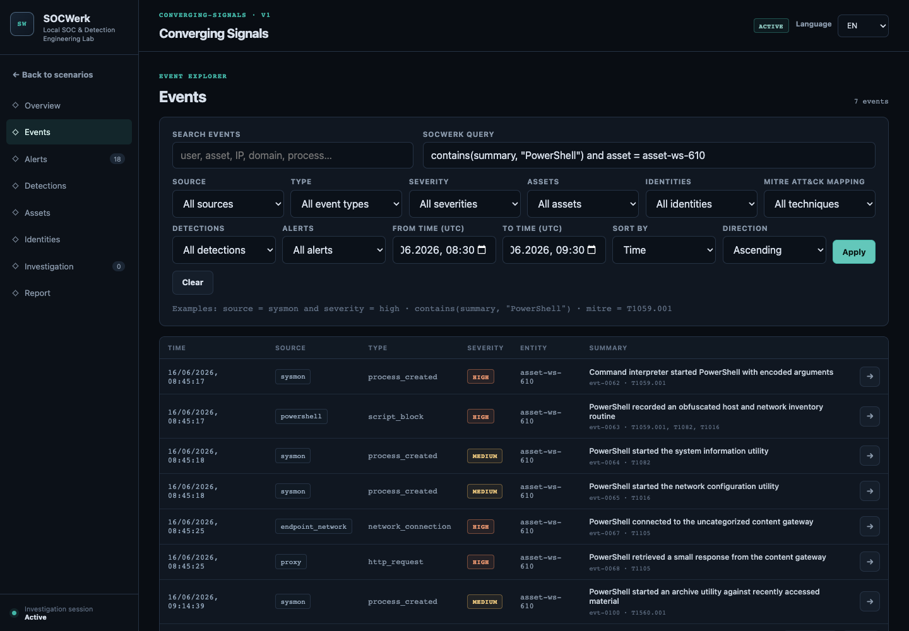
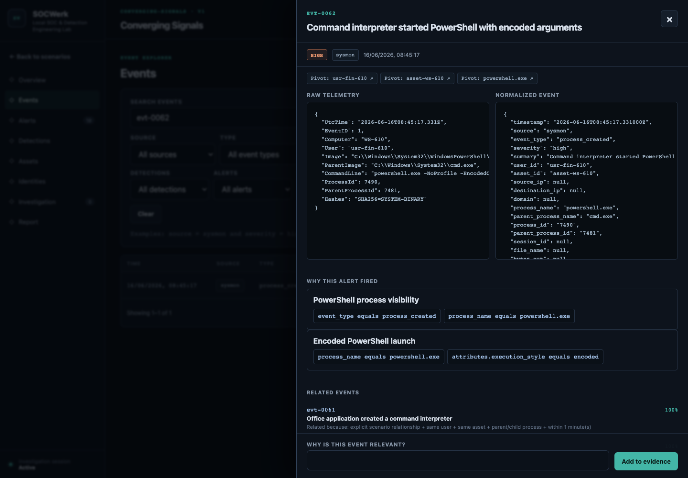
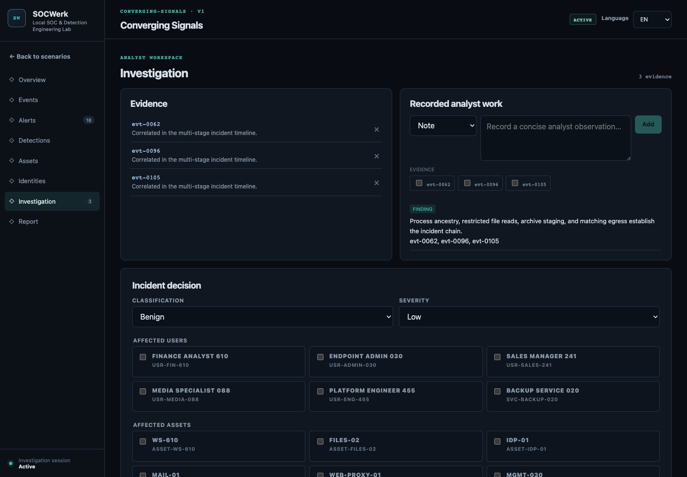
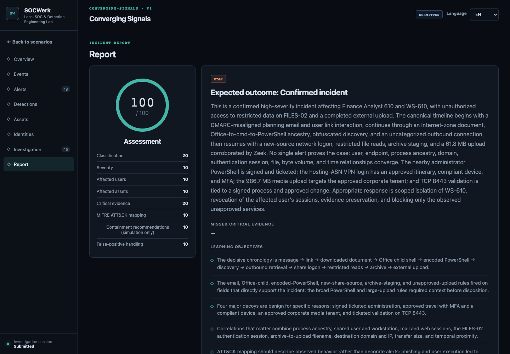

# SOCWerk

**Local SOC & Detection Engineering Lab**

SOCWerk is a compact local security operations environment for investigating synthetic incidents from raw telemetry through normalization, explainable detections, alert triage, evidence correlation, containment decisions, assessment, and reporting.

It is an analyst workspace, not a quiz. Each scenario mixes suspicious and legitimate behavior across realistic defensive data sources. The analyst has to establish what happened, preserve evidence, test hypotheses, document findings, classify the incident, and recommend simulated containment.

## Product tour

### Investigation overview



### Event Explorer



### Raw telemetry, normalization, and detection explanation



### Analyst investigation workspace



### Incident assessment and report



## Investigation workflow

```text
Raw security telemetry
        ↓
Normalized SOCWerk event
        ↓
Explainable detection match
        ↓
Alert triage
        ↓
Evidence and correlation
        ↓
Finding and incident decision
        ↓
Simulated containment
        ↓
Markdown / JSON / HTML report
```

The application exposes both source-shaped raw records and a consistent normalized representation. Detection matches show the exact fields, operators, expected values, and observed values responsible for an alert. Related-event suggestions state why the records are connected.

## Highlights

- Searchable, paginated Event Explorer with source, type, severity, asset, identity, MITRE ATT&CK, free-text, and safe query filtering.
- Raw and normalized telemetry from Windows Security, Sysmon-style events, PowerShell operational logs, identity providers, MFA, VPN, DNS, email, proxy, endpoint file/network activity, Zeek-style metadata, DLP, and change control.
- Deterministic, non-executable detection engine with Sigma-inspired source content and field-level match explanations.
- Controlled alert lifecycle: New → In Progress → Escalated, Benign, False Positive, or Confirmed Incident.
- Explainable correlation using shared entities, process ancestry, session identifiers, time proximity, and explicit scenario relationships.
- Persistent evidence, notes, hypotheses, findings, alert decisions, and incident decisions in SQLite.
- Backend-enforced solution protection and deterministic post-submission assessment.
- Professional Markdown, JSON, and standalone HTML incident report exports.
- Complete English and German UI, including localized scenario descriptions, objectives, baselines, detection context, containment choices, and assessment explanations.
- Responsive dark interface with keyboard focus, semantic controls, reduced-motion support, and narrow-screen layouts.
- Strict, versioned JSON scenario packs that do not load code or remote content.

## Included scenarios

| Scenario | Investigation focus | Key telemetry | Benign lookalike |
| --- | --- | --- | --- |
| **Converging Signals** · Advanced · 30–45 min | Multi-stage compromise reconstruction, cross-source correlation, false-positive triage, and containment priority | 192 events across email, Office, Sysmon, PowerShell, Windows Security, VPN/MFA, DNS, proxy, endpoint, and Zeek-style sources | Signed PowerShell administration, approved travel, a larger corporate upload, and ticketed alternate-port validation |
| Suspicious Login Activity | Account takeover, failure/success sequences, MFA, VPN | Identity provider, MFA, VPN, Windows Security | Approved travel through a hosting network |
| Phishing Investigation | Message authenticity, link interaction, endpoint impact | Email, browser, DNS, proxy, Sysmon-style process/file/network | Approved external employee survey |
| Suspicious PowerShell Execution | Process ancestry, script blocks, discovery, network access | Sysmon-style process/file/network, PowerShell 4104, proxy, change control | Signed inventory script in an approved window |
| Suspicious File Transfer | File staging, destination context, transfer volume, cleanup | File audit, endpoint file activity, DNS, proxy, DLP | Larger approved corporate media upload |

All identities, domains, addresses, files, and infrastructure in the scenarios are synthetic. Network indicators use documentation-reserved address ranges and `.example` domains.

Converging Signals is an original SOCWerk-native dataset. Its investigation design is informed by the multi-source hunting philosophy of [Splunk Boss of the SOC](https://github.com/splunk/botsv3) and the connected-behavior model of [MITRE Attack Flow](https://ctid.mitre.org/projects/attack-flow/); no external event records or scenario answers are reproduced.

## Quick start with Docker

Prerequisites: Docker with Compose support.

From a local checkout of this repository:

```bash
cd socwerk
docker compose up --build
```

Open [http://localhost:5173](http://localhost:5173). The API is available at [http://localhost:8000](http://localhost:8000), with interactive local documentation at `/api/docs`.

Investigation state is stored in the `socwerk-data` Docker volume. Stop the application with `Ctrl+C`; use `docker compose down` to remove containers while retaining the volume.

## Local development

Prerequisites:

- Python 3.11 or newer
- Node.js 20 or newer

Install the backend and frontend dependencies:

```bash
python3 -m venv .venv
.venv/bin/pip install -e 'backend[dev]'
cd frontend && npm install && cd ..
```

Run the API and web application in separate terminals:

```bash
make dev-api
make dev-web
```

The default local settings are documented in [.env.example](.env.example). The defaults work without creating an environment file.

## Architecture

SOCWerk uses a deliberately small deployment:

```text
SvelteKit analyst workspace
          │ JSON over HTTP
          ▼
FastAPI domain/API layer
    ├── read-only scenario repository
    ├── query and detection evaluators
    ├── correlation and scoring services
    └── SQLite analyst state
```

Scenario facts remain immutable. Only analyst state is written to SQLite. The browser never receives expected outcomes before submission. Detection and query definitions are declarative data interpreted by bounded operators; no scenario can provide executable code.

See [Architecture](docs/architecture.md), [Threat model](docs/threat-model.md), and [Telemetry and detection model](docs/telemetry-and-detections.md) for the design rationale and trust boundaries.

## Scenario authoring

Scenario packs live under `scenarios/<scenario-id>/scenario.json` and declare metadata, localizations, entities, raw and normalized events, rules, relationships, containment choices, and the protected expected outcome. Validation covers schema shape, duplicate identifiers, cross-references, chronology, localization, and declared detection matches.

The [Scenario authoring guide](docs/scenario-authoring.md) documents the complete workflow, schema, safe content rules, detection operators, and validation commands.

## Queries and filtering

The Event Explorer accepts a small read-only query language:

```text
source = sysmon
user_id = usr-ops-402 and severity = high
mitre = T1059.001
contains(summary, "PowerShell")
(event_type = process_created or event_type = network_connection) and asset_id = asset-ws-402
```

Queries are parsed into in-memory predicates. They are never passed to SQL or an evaluation runtime. See [Query language](docs/query-language.md).

## Testing and validation

Run the same validation used by continuous integration:

```bash
make validate
```

This performs backend formatting/lint checks and tests, frontend type checks/tests/build, scenario and detection integrity validation, repository privacy/sanity checks, and Docker Compose configuration validation.

Focused commands are also available:

```bash
.venv/bin/pytest backend/tests
.venv/bin/ruff check backend
cd frontend && npm run check && npm test && npm run build
.venv/bin/python scripts/validate_scenarios.py
.venv/bin/python scripts/build_advanced_scenario.py --check
docker compose config --quiet
```

With the Compose stack running, `make smoke` exercises a complete live investigation, assessment, export, and reload workflow against both services.

## Security boundaries

SOCWerk is defensive, synthetic, and local. It does not scan networks, send phishing, generate payloads, execute scenario commands, connect to targets, or perform containment against external systems. Containment choices only become report entries.

Scenario JSON is treated as untrusted content: it is loaded only below the configured scenario directory, parsed with strict models, rendered as text by the UI, and never used for filesystem or network access. Database operations are parameterized, the investigation query language is constrained, and normal API errors do not expose stack traces.

For responsible reporting and supported versions, see [SECURITY.md](SECURITY.md).

## Localization

English is the source language. The UI automatically selects German for a German browser preference and persists manual language selection. Scenario packs require both English and German for all analyst-facing localized fields.

The German operational-context text is educational. SOCWerk makes no certification, regulatory, or legal-compliance claim.

## Roadmap

The v1 architecture leaves clear extension points for contributor-authored scenarios, additional safe normalization profiles, and richer timeline visualization. Additions should preserve local operation, deterministic behavior, and explainable analyst decisions; external SIEM or offensive capabilities are outside the project boundary.

## Contributing

Contributions are welcome for scenarios, telemetry normalization, detection content, accessibility, localization, tests, and documentation. Read [CONTRIBUTING.md](CONTRIBUTING.md) before proposing changes.

## License

SOCWerk is available under the [MIT License](LICENSE).
